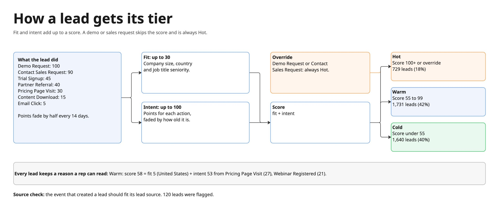
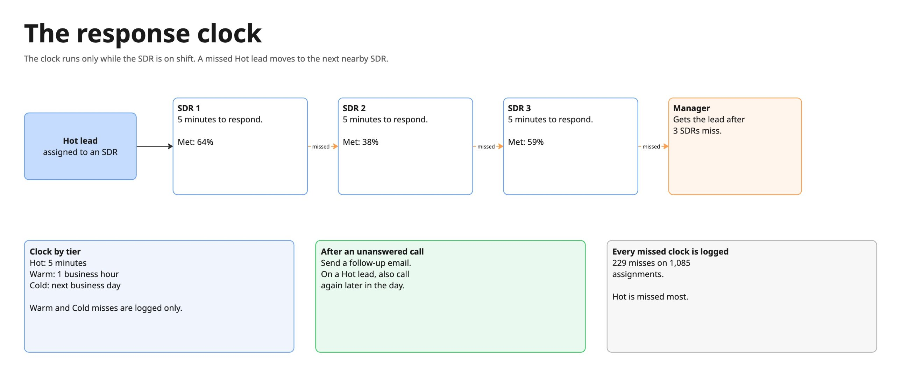
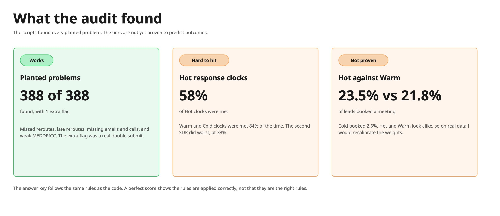
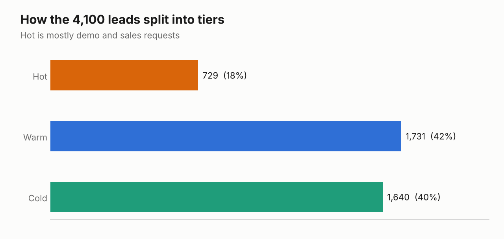
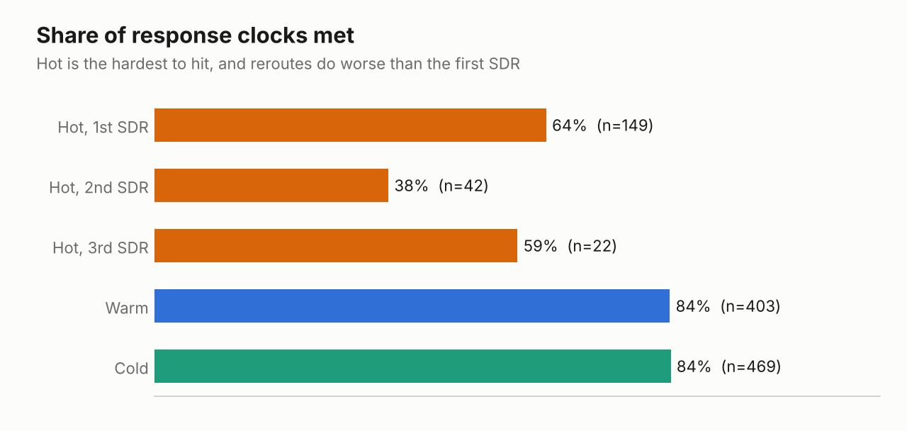
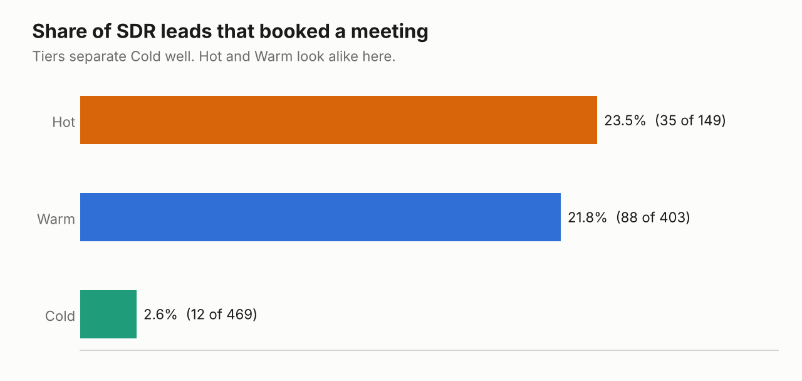

# Lead Scoring, Tiers and SLAs

A new lead should get the right kind of attention, fast. This project does four things for 4,100 leads:

1. Scores each lead and puts it in a tier (Hot, Warm, Cold), with a plain-English reason a rep can read.
2. Checks that the lead source is believable.
3. Audits the response-time rules (SLAs) for the 1,021 net-new leads that went to SDRs.
4. Checks that SDR qualification (MEDDPICC) and the path to SQL follow the policy.

It runs on the synthetic CRM data from [gtm-synthetic-data](https://github.com/maleekduckett/gtm-synthetic-data)(private repo with reusable synthetic data for projects) and builds on [lead-account-matching](https://github.com/maleekduckett/lead-account-matching), which decides who owns each lead. Every record is made up.



## The policy this implements

- Net-new leads go to inbound SDRs, who qualify them with MEDDPICC. Not every field is needed to book a discovery meeting. The minimum is pain plus one more field.
- A lead becomes an SQL only after the AE's discovery call.
- Response clocks run on the SDR's own working hours (their timezone, Monday to Friday).

| Tier | Respond within | If the SLA is missed |
|---|---|---|
| Hot | 5 minutes | Reroute to a nearby SDR. After 3 SDRs have missed, escalate to the manager. Every miss is logged. |
| Warm | 1 business hour | Logged |
| Cold | Next business day (8 business hours) | Logged |

After a call that is not answered, the SDR sends a follow-up email. For a Hot lead, the SDR also calls again later.



## How a tier is decided

`score = fit + intent`

- **Fit** is up to 30 points: company size, country, and job title seniority.
- **Intent** is up to 100 points, from what the lead did. A demo request is worth far more than an email click. Points fade with a half-life of 14 days, and the same action twice within 2 minutes counts once.
- **Hot** at 100 or more. **Warm** at 55 or more. **Cold** below that.
- **Override:** a Demo Request or Contact Sales Request is always Hot.

| Action | Points |
|---|---|
| Demo Request | 100 (Hot override) |
| Contact Sales Request | 90 (Hot override) |
| Trial Signup | 45 |
| Partner Referral, Outbound Reply | 40 |
| Pricing Page Visit, Webinar Attended | 30 |
| Event Badge Scan | 25 |
| General Inquiry | 20 |
| Webinar Registered, Content Download | 15 |
| Email Click | 5 |

Every lead gets a stored reason, for example:

> Warm: score 58 = fit 5 (United States) + intent 53 from Pricing Page Visit (27), Webinar Registered (21).

The reason is in `results/lead_scores.csv`, so a rep can see the source and the activity behind a tier.

**Source check.** The event that created a lead should fit its lead source. A "Webinar" lead created by a Demo Request is flagged. The check does not decide which one is wrong. It tells someone to look.

## Results

| | |
|---|---|
| Hot / Warm / Cold | 729 (18%) / 1,731 (42%) / 1,640 (40%) |
| Hot because of a demo or sales request | 563 |
| Lead source does not fit the creating event | 120 |
| SLA assignments audited | 1,085 on 1,021 leads |
| SLAs met | 78.9% overall. Hot 58%, Warm 84%, Cold 84% |
| Missed SLAs logged | 229 |
| SDR meetings booked | 135 |

Hot is the hardest tier to hit. Five minutes is tight, and the second and third SDRs do worse than the first (see `results/report.txt`).



### Charts







### Problems found

Planted in the data, then looked for by the audit scripts:

| Problem | Planted | Found |
|---|---|---|
| Lead source does not fit the creating event | 120 | 120 |
| Event recorded twice within seconds | 70 | 70 (plus 1 real repeat) |
| Hot SLA missed, no reroute | 16 | 16 |
| Reroute came more than 5 minutes late | 8 | 8 |
| Third SLA missed, manager never assigned | 3 | 3 |
| No follow-up email after an unanswered call | 46 | 46 |
| No second call on a Hot lead | 15 | 15 |
| Meeting booked below the minimum (no pain, or fewer than 2 fields) | 35 | 35 |
| Marked SQL with no discovery call | 20 | 20 |
| Marked Qualified with no meeting booked | 55 | 55 |

The answer key comes from the data generator, which follows the same written rules as this code. A perfect score shows the code applies the rules correctly. It doesn't show these are the right rules for a real business. The one extra flag was a real double submit that the generator did not plant, and the audit was correct to flag it.

### Does the tier predict outcomes?

| Tier | Net-new leads | Meetings booked | Booked |
|---|---|---|---|
| Hot | 149 | 35 | 23.5% |
| Warm | 403 | 88 | 21.8% |
| Cold | 469 | 12 | 2.6% |

The tiers separate Cold or Passive leads from the other lead tiers pretty well. Hot and Warm are almost the same. In this dataset the outcomes weren't built to depend on the tier, so I wouldn't read much into it. On real data, this is the first thing I would check, and if Hot and Warm look alike I would recalibrate the weights.

## What the files do

| File | Job |
|---|---|
| `common.py` | The rules (points, thresholds, SLA minutes) and the business-hours clock |
| `score_leads.py` | Fit, intent, tier, reason, source check |
| `audit_sla.py` | Response clocks, reroute chain, escalation, miss log, follow-up checks |
| `check_qualification.py` | MEDDPICC completeness and the SQL rule |
| `grade.py` | Compares everything to the answer key. The only file that reads it |
| `report.py`, `sql/report.sql` | Summary tables, written in SQL |
| `charts.py` | Draws the charts in `docs/` |
| `tests/test_rules.py` | Checks the clock (nights, weekends, daylight saving) and the scoring rules |

## Run it

```bash
git clone https://github.com/maleekduckett/gtm-synthetic-data   # next to this repo
pip install -r requirements.txt
python score_leads.py
python audit_sla.py
python check_qualification.py
python grade.py
python report.py
python charts.py   # needs matplotlib
python tests/test_rules.py
```

Use `--data-dir` if the data is somewhere else.

## Limits

- The SLA is evaluated when a lead is created. A tier that changes later (a lead who requests a demo a week after downloading a guide) is not given a new clock.
- Scores are computed as of the moment the lead was created. A live system would rescore as new activity arrives.
- Weights and thresholds are my judgment, set once. I did not fit them to outcomes.
- Reroutes pick a nearby region. The data only has US regions, so Canada and EMEA reroutes are not exercised.
- The clock ignores holidays and time off.
